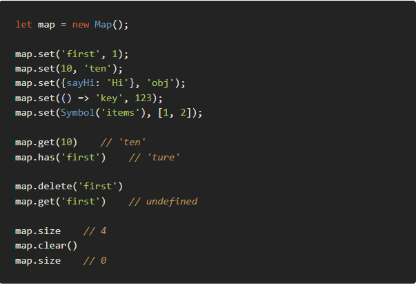

自己選的路，跪著也要走完

## Problem No.
[LeetCode - 1. Two Sum](https://leetcode.com/problems/two-sum/)

## Mind of the problem
題目中Input一陣列(nums) 及一數字(target),
需算出陣列中哪兩個數字組成題目給的數字，並 Return。

直觀上來說，第一個想到曾在C++透過巢狀loop去地毯式搜尋，不過意外發現JavaScript有個Map()的涵式，類似留著看過的數字，就想說順手用一下，具體筆記放在下方Note欄位。

## Code

```javascript
var twoSum = function(nums, target) {
    let map = new Map(); //新增Map陣列集合，存在map中

    for(let i=0;ilength;i++){
        let num1=nums[i];
        let num2=target-num1;
        if(map.has(num2)){ //檢查map中是否有key是num2
            return[i,map.get(num2)]; //取得key是 num2的 value
        }

        map.set(num1,i); //新增map內容 
    }
};
```

## Note (ES6)

- 變數宣告 let 在ES6新的宣告中，用以取代var，來解決var區域變數洩漏成全域變數的問題(註1)。 var宣告屬於函數內、let宣告屬於區塊。 相較var，let生存範圍較小(註2)，在使用上也較嚴謹，讓開發專案能更加穩定，並增加可讀性。 註1: 區域變數覆蓋全域變數或者for loop中循環變數洩漏為全域變數

> - 註2: 因為JS的變數提升，var可以在函式先使用才宣告； 但由於未初始化，宣告前的使用，在印出後該值皆是undefined。 而let則是要宣告後才能使用。

- const 固定值，宣告多少就是多少，後面無法重新賦值。

- JavaScript ES6 Map 物件 Map為一個類似一維陣列的資料結構，內部為[key,value] 正常透過動用key的值去呼叫、使用value。 宣告、產生Map物件: let map = new Map(); 呼叫整組資料結構: for (let [key, value] of map) {} 基本使用方式 set(key, value) 新增內容 map.set(‘key’, ‘value’);

- has(key) 檢查是否存在此 key，有則返回ture，無則返回false map.has(key);

- get(key) 獲取指定 key 的內容，找不到返回undefined map.get(key);

- delete(key) 刪除指定 key 的內容 map.delete(key);

- clear() 刪除所有內容成員 map.clear();

- size 取得內容成員總數 map.size();

Example:


- 資料連結 [ES6 總整理](https://ithelp.ithome.com.tw/articles/10197716#:~:text=ES6%20%E5%85%B6%E5%AF%A6%E6%98%AF%E4%B8%80%E5%80%8B%E6%B3%9B,%E4%B9%9F%E5%B0%B1%E6%98%AFES6%20%E8%AA%9E%E8%A8%80%E6%A8%99%E6%BA%96%E3%80%82) [let,var 差異](https://totoroliu.medium.com/javascript-var-let-const-%E5%B7%AE%E7%95%B0-e3d930521230)
