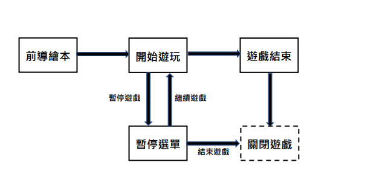
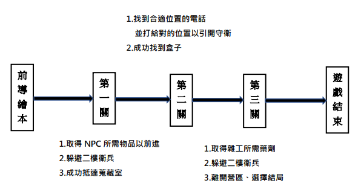
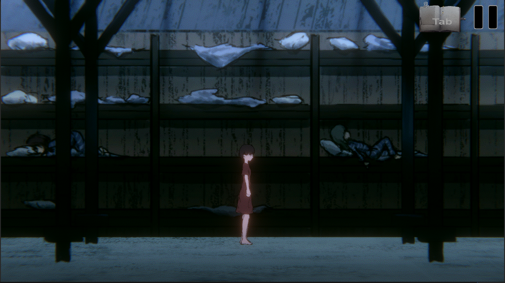
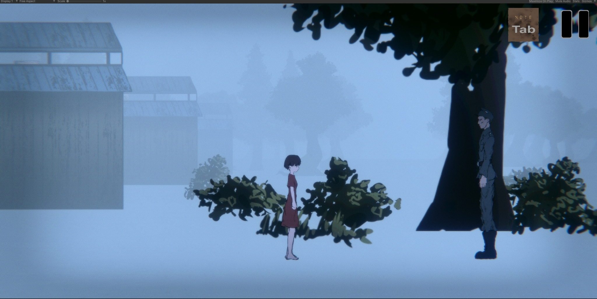
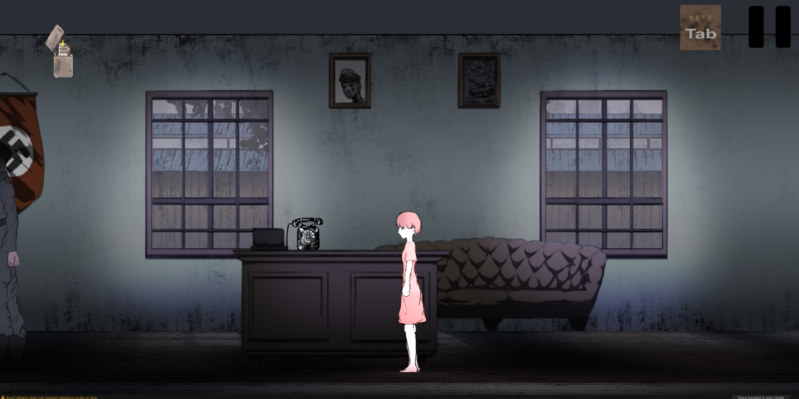
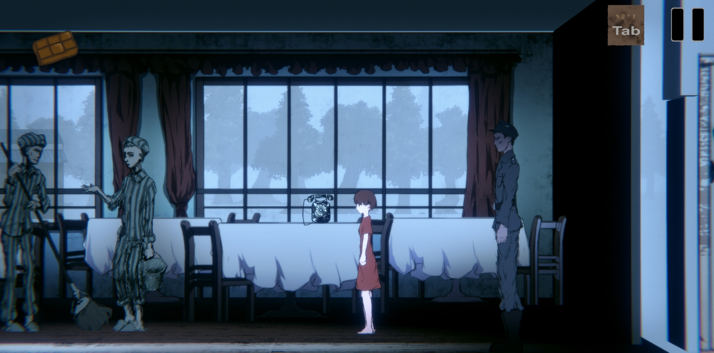
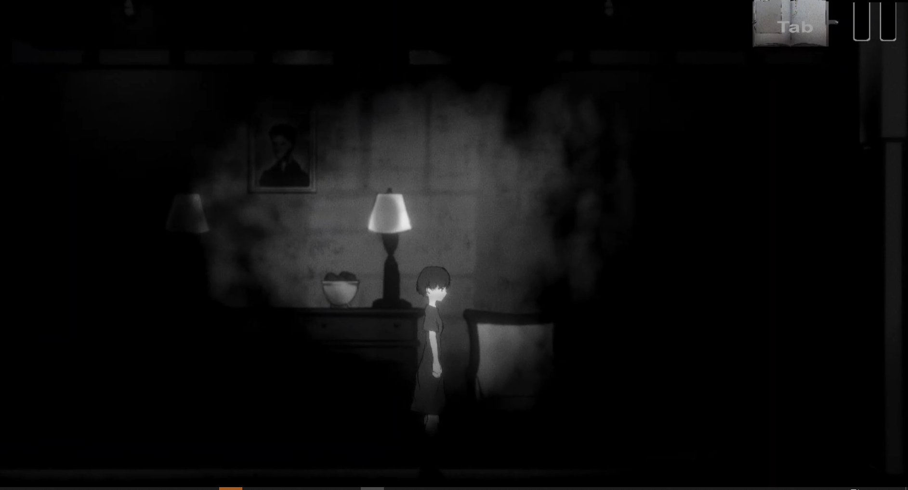

小畢製 幹你的

## Work Title.
[Unity - 110-2 Game Ptoject ‘Auschwitz Zoo](https://github.com/Mitrofan2001/110-2-Game-Auschwitz-Zoo)

## Mind of the Work
從發想上來說，老師的題目是’欺騙’，因此，在討論過後，我們希望以故事中善意的的欺騙做發揮。其中，我們取材自’雙生夢魘’；作者 Affinity Konar，取材自真實事件，內容講述們格勒醫生在集中營對多位雙胞胎做人體實驗，本遊戲的主角史塔莎、貝兒則是其中並存活下來的眾多受害者之一。

---

## Some Prepare work before we start to make this
 遊戲設定：

- 遊戲玩法： 尋找特定物件並躲避衛兵巡邏以完成交辦任務

- 在卡關時可以翻閱筆記本以獲得方向或線索

- 逃出來!

- 操作方式 左右移動：W、S

- 互動、開門、上樓梯：E

- 筆記本(任務提示)：Tab

- 暫停：滑鼠點擊

- 背景故事 二戰期間，納粹當中有一部份軍醫，並非作為醫治他人的天使存在，而是將人體拿來做實驗的惡魔。尤其在惡名昭著的奧茲維辛營，門格勒醫生特別喜歡以多胞胎為人體實驗的對照物，並蒐藏實驗器官，因此，他的實驗室甚至獲得別稱：「門格勒的動物園」

- 遊玩流程： 

- 破關流程： 

## Photo on gaming

## How to use

- 下載後解壓縮

- 點開 demo20220314.exe 便可以玩囉

---

## Unity tips

- 音效 這裡要分成兩個屬性 [Audio Listener](https://docs.unity3d.com/Manual/class-AudioListener.html) 負責聽的 通常會綁在main carmera上

- [Audio Source](https://docs.unity3d.com/Manual/class-AudioSource.html) 負責吵得? 放在那些發出聲音又會移動的物體上，常見的做法是將處理後的音檔整理成單獨的Audio source，並經過調教後，綁在物件動作的script上(ex:走路-腳步聲)，以便動作時方便開關音源，甚至搭配動作快慢改變頻率

- [碰撞](https://ithelp.ithome.com.tw/articles/10261685) 有兩個種類： OnCollision 造成物理碰撞，可以在碰撞時執行Script內的OnCollision函式。

- OnCTrigger 取消物理碰撞，可以在觸發時執行Script內的OnTrigger函式。所以兩個物件A跟B接觸時，不可能同時產生碰撞+觸發，最多產生其中一種，但是可以辦到讓A跟B產生碰撞，A跟C產生觸發。

- [向下的地心引力](https://www.youtube.com/watch?v=dbAdLs-NlzI&ab_channel=JimmyVegas) 幫物件增加剛體 Rigidbody屬性

- 點選 use gravity

- 若要針對某件物體作吸引 則需要額外使用script控制
