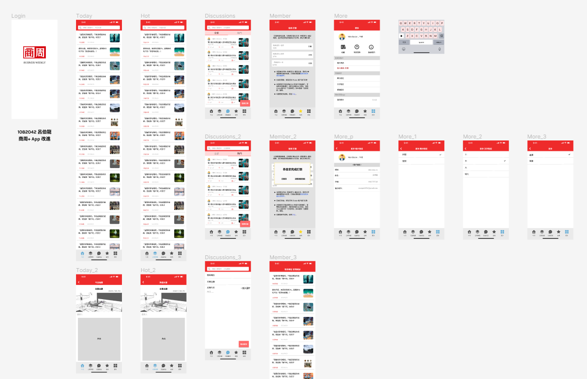

繳交截止前12個小時通宵搞出來的東西

## Work Title.
[Figma - Business Weekly UI](https://www.figma.com/file/zPyybCRGoDgjsGggd3SJWH/1082042_Final?node-id=0:1)

## Mind of the Work
基本上這個是最後一個的期末作業，因為拖延+前面的作業，想說乾脆放掉這半個期末作業，

不過在deadline前12小時越想越不對，之前有個超優秀學長僅只因為這項作業沒註記名字最後被當；

那個當下我只想到 “我必須趕在最後繳交期限前12小時搞定他。”

本次期末作業以改良參考的APP作為主題，需要去找APP並結合所學改良他，使User更方便使用、瀏覽資訊

而其中我主要參考了 商周+ App 、天下雜誌 、 今周刊以及Dcard

並以商周+ App 作為強化介面設計對象加以更改

前三者主要參考其內容配置、顏色搭配(皆以紅色為底

而Dcard部分則是參考其下方 fixed的功能選單

---

## UX research before design
來不及做麻(攤手)

## UI Design

---

## How to use
經logo進入頁面後，會來到每日推薦文摘

並可以透過下方欄位進行左右切換至(熱議文章 / 看版討論)

或者至會員專區閱讀出刊內容

若需要設定、也可以至類別欄位最右側進行帳務檢查及功能設置

## Figma tips

- input textbox call keyboard 點擊你要設定要打字的框框點開右側的phototype，把interaction detials的 none 增加 on tap，下方將出現彈出方式並選擇你要彈出的鍵盤樣式，一切搞定後，可以在最下方動畫自行決定動畫(來自的方向跟速度等)。

- 記得增加每個頁面的返回鍵
